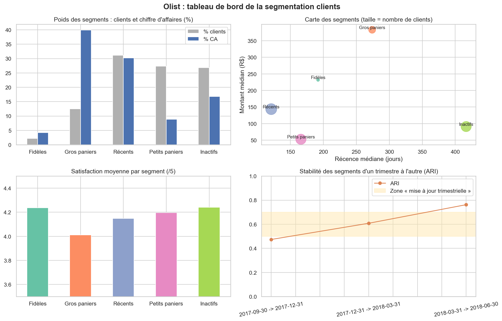

# 🛍️ Olist : segmentation RFM des clients et marketing prédictif

> Projet collectif réalisé dans le cadre du MSc Data Marketing Manager, INSEEC (2026)  
> **Équipe :** Ghita El Fathy · Akebrou Aké · Jean-Philippe Nioule · Beni Ambeto

---

## 📌 Objectif

Fournir aux équipes e-commerce d'Olist une **segmentation des clients utilisable au quotidien** pour leurs campagnes publi-promo, avec :
- un **diagnostic** des transactions (forces et faiblesses des données) ;
- des **segments décrits de façon actionnable**, avec leurs cibles, leurs indicateurs et des **objectifs SMART** ;
- une **fréquence de mise à jour** justifiée par la stabilité des segments dans le temps ;
- un **tableau de bord** de suivi et le respect du **RGPD**.

---

## 📊 Dataset

| Caractéristique | Valeur |
|---|---|
| Fichier | `data/base_donnees_v2.csv` : base consolidée du groupe (tables commandes, articles, paiements, avis, produits, clients et vendeurs déjà jointes) |
| Source | Extrait du [Brazilian E-Commerce Public Dataset by Olist](https://www.kaggle.com/datasets/olistbr/brazilian-ecommerce) (Kaggle), licence CC BY-NC-SA 4.0 |
| Entreprise | Olist, plateforme brésilienne qui relie de petits marchands aux grandes marketplaces ; montants en reais (R$) |
| Période | octobre 2016 à août 2018 |
| Lignes | 74 818 (une ligne par article et par paiement), 39 colonnes |
| Commandes livrées | 65 119 |
| Clients uniques (`customer_unique_id`) | 61 041 |
| CA (articles + port) | 10,5 M R$ |

---

## 🔧 Stack technique


---

## 📁 Structure du projet

```
olist-segmentation-rfm/
│
├── segmentation_rfm_olist.ipynb   # Notebook principal (toutes les analyses, exécuté)
├── data/
│   └── base_donnees_v2.csv        # Base consolidée du groupe
├── outputs/
│   ├── dashboard_segments.png     # Tableau de bord de la segmentation
│   ├── segments_clients.csv       # Segment de chaque client (pour l'e-mailing ou Power BI)
│   └── synthese_segments.csv      # Profil chiffré des 5 segments
└── README.md
```

---

## 🔍 Analyses réalisées

### 1. Préparation et contrôle qualité
- Retour au bon niveau d'analyse : la base compte une ligne par article et par paiement. On passe à **une ligne par commande**, puis à **une ligne par client** (`customer_unique_id`, car `customer_id` change à chaque commande)
- **Lignes coupées** : 3 125 lignes (2 656 commandes) perdent toutes leurs colonnes après le commentaire de l'avis (dates de l'avis, produit, client, vendeur) ; la cause n'est pas visible dans le fichier. Le client est récupéré quand une autre ligne de la commande le donne ; sinon la commande est gardée pour le diagnostic mais exclue du RFM (96 % des commandes livrées restent segmentables)
- **Montant payé faux sur la fin du fichier** : à partir de la ligne 58 270 environ, `payment_value` vaut *prix × un multiplicateur qui augmente de ligne en ligne + port*, jusqu'à plus de 100 fois le montant des articles et du port. C'est une formule Excel recopiée vers le bas. **Le montant est donc recalculé à partir des prix et des frais de port**, qui sont cohérents sur tout le fichier

### 2. Diagnostic
- **Croissance** forte de 2017 à 2018, avec un record en **novembre 2017** (Black Friday : 4 868 commandes livrées)
- **Paiement** : 77 % par carte de crédit, 3,6 mensualités en moyenne
- **Satisfaction** : note moyenne de 4,1/5, mais 13 % de notes de 1 ou 2
- **Livraison** : 6,6 % des commandes arrivent en retard, et leur note moyenne tombe à **2,27 contre 4,28**
- **Géographie** : 42 % des clients dans l'État de São Paulo

### 3. Indicateurs RFM
- **Récence** (jours depuis le dernier achat), **Fréquence** (commandes livrées), **Montant** (articles + port)
- Constat central : **97,8 % des clients n'ont acheté qu'une seule fois**. La fréquence ne distingue qu'une petite minorité ; la segmentation repose surtout sur la récence et le montant

### 4. Clustering K-Means
- Variables : R, log(1 + F), log(1 + M), standardisées (z-score)
- Coude et silhouette pour k de 2 à 8. **k = 2** a la meilleure silhouette (0,74) mais ne fait que séparer les multi-acheteurs du reste : écarté. De k = 3 à 8, la silhouette reste entre 0,34 et 0,37
- **k = 5 retenu** : k = 4 a la meilleure silhouette (0,37) et isole déjà les multi-acheteurs, mais k = 5 sépare en plus les **gros paniers** (environ 40 % du CA), cible prioritaire, pour 0,02 point de silhouette en moins. Noms attribués par des règles lues sur les profils, pour un résultat reproductible

| Segment | Clients | % clients | % CA | Récence médiane | Montant médian | Note moyenne |
|---|---:|---:|---:|---:|---:|---:|
| Fidèles | 1 323 | 2,2 % | 4,2 % | 192 j | 232 R$ | 4,2 |
| Gros paniers | 7 636 | 12,5 % | **39,9 %** | 274 j | 383 R$ | 4,0 |
| Récents | 19 015 | 31,2 % | 30,2 % | 121 j | 144 R$ | 4,1 |
| Petits paniers | 16 705 | 27,4 % | 8,9 % | 166 j | 53 R$ | 4,2 |
| Inactifs | 16 362 | 26,8 % | 16,8 % | 417 j | 91 R$ | 4,2 |

### 5. Stabilité et fréquence de mise à jour
- Segmentation recalculée à la fin de 4 trimestres et comparée sur les clients communs avec l'**indice de Rand ajusté (ARI)**
- ARI de 0,47, 0,61 puis 0,76 (moyenne **0,61**) → **mise à jour trimestrielle**, revue du modèle une fois par an



---

## 💡 Recommandations

Le levier commercial est le **deuxième achat** : aujourd'hui, seuls **1,1 %** des clients repassent commande dans les 90 jours.

1. **Gros paniers** (12,5 % des clients, 39,9 % du CA) : priorité n° 1. Relance personnalisée sur la catégorie achetée, offre de 2ᵉ achat et suivi de satisfaction, car leur note est la plus basse.
2. **Récents** (31 % des clients) : parcours d'accueil avec e-mails à J+7 et J+30 et enquête post-achat, avant qu'ils ne deviennent inactifs.
3. **Fidèles** (2 %) : programme de fidélité et accès anticipé aux nouveautés.
4. **Petits paniers** : montée en gamme (seuil de frais de port offerts, lots, ventes croisées).
5. **Inactifs** : une seule campagne de réactivation à faible coût, puis baisse de la pression commerciale.

**Objectif SMART** : doubler le taux de 2ᵉ commande à 90 jours sur les segments Gros paniers et Récents en 6 mois, avec un premier point à 3 mois, au moment de la mise à jour trimestrielle. En parallèle, réduire les retards de livraison, qui coûtent 2 points de note.

**RGPD** : données d'achat uniquement, identifiants pseudonymisés, finalité limitée au ciblage marketing, consentement pour les envois, conservation limitée à 3 ans après le dernier achat (la LGPD brésilienne s'applique aussi).

---

## ⚠️ Limites et pistes d'amélioration

- **Base partielle** : la base V2 contient environ deux tiers des commandes du jeu Olist complet, réparties régulièrement dans le temps. Les proportions restent représentatives, mais pas les volumes.
- **Montant recalculé** : articles + port, sans les intérêts des paiements en plusieurs fois ni les bons d'achat.
- **Articles manquants** : comparée au jeu Kaggle d'origine, la base omet une partie des articles de 755 commandes (environ 1 %), dont le montant est donc sous-estimé.
- **Silhouette modérée (environ 0,35)** : les segments se chevauchent ; ce sont des profils de travail, pas des catégories naturelles.
- **Fréquence peu discriminante** : avec près de 98 % d'acheteurs uniques, un score F classique de 1 à 5 n'a pas de sens ici.
- **Pas de données socio-démographiques** : la segmentation décrit comment les clients achètent, pas qui ils sont.
- **Objectifs à tester** : le gain attendu des campagnes est à valider par un test A/B (groupe contacté contre groupe témoin) avant d'être généralisé.

---

## ▶️ Lancer le notebook

```bash
# Cloner le dépôt
git clone https://github.com/jpnioule/olist-segmentation-rfm.git
cd olist-segmentation-rfm

# Installer les dépendances
pip install pandas matplotlib seaborn scikit-learn

# Lancer Jupyter
jupyter notebook segmentation_rfm_olist.ipynb
```

---

*Projet académique · MSc Data Marketing Manager, INSEEC, 2026*
